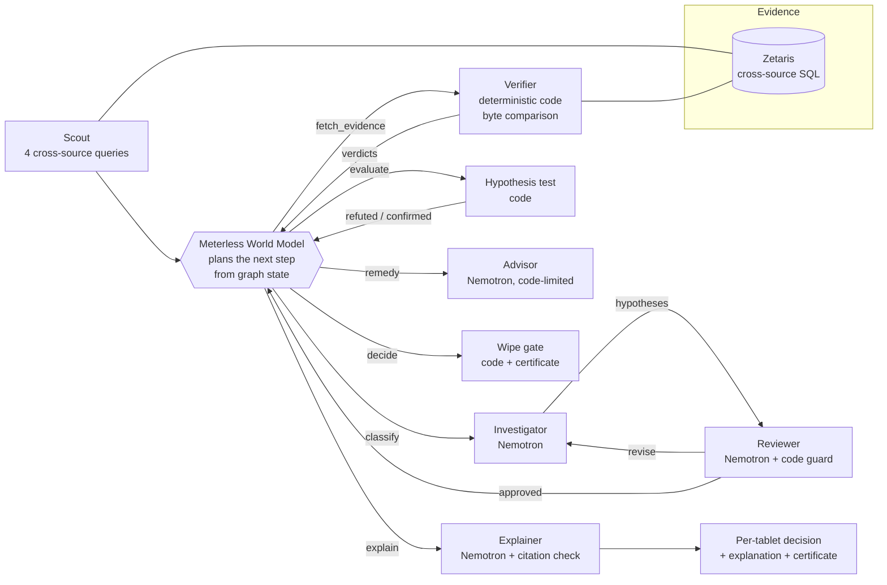

# LastCopy — *is it safe to wipe this tablet?*

> **Track:** The Agent That Can Explain Why · Open Agent Hackathon 2026
> **Sponsor technology:** Zetaris (cross-source evidence SQL) · Meterless World Model (plans every step) · Meterless Nightshift → NVIDIA Nemotron (judgement roles) · built with Codex
> **Try it in 10 seconds, no keys:** `python run.py` · **Live site:** <https://lastcopy-five.vercel.app> · **Demo video:** [`submission/LastCopy-demo.mp4`](submission/LastCopy-demo.mp4)

Field survey teams reset their tablets between rounds. That reset is the moment
unsent records and photos are lost for good, and the server's "received" count
cannot tell you what is still only on the device. **LastCopy gives the field
coordinator one answer per tablet — SAFE TO WIPE, RECOVER FIRST or HOLD — and
proves why**, down to the record, the repeated answer and the photo file.

```
  DEVICE       DECISION       WHY  (python run.py, five-tablet example, 4 s, no network)
  tablet-01    SAFE_TO_WIPE   The spreadsheet export omits some repeated answers, but the raw server XML holds all of them. 2 completed records matched byte-for-byte.
  tablet-02    RECOVER_FIRST  finding-3: the file b.bin for uuid:fleet-02-a is not on the server.
  tablet-03    RECOVER_FIRST  finding-5: the whole record for uuid:fleet-03-b is not on the server.
  tablet-04    HOLD           finding-6: the server copy of uuid:fleet-04-a has different answers; a person must choose.
  tablet-05    HOLD           No export was received from this device, so nothing on it has been checked.
```

## 1. Who it is for and why it matters

**User:** the field coordinator or data manager of a survey team using ODK, the
open-source standard for offline data collection. ODK reports more than
2 million people sending over 250 million submissions a year
([getodk.org](https://getodk.org/)); it is a recognised Digital Public Good
deployed in 194 countries, used by the WHO for disease surveillance including
polio and cholera ([DPG registry](https://digitalpublicgoods.net/registry/odk.html)).

**Problem:** "Submitted" is not "preserved." A record can arrive without its
photo; a spreadsheet export can hide repeated answers that the server actually
has; a record can sit unsent on one tablet while the totals still look right.
Coordinators wipe devices on trust because checking by hand means opening XML
and media files one by one.

**Decision supported:** before resetting each tablet, *can I wipe it, must I
recover something first, or must a person look?* Every answer comes with a
hashed clearance certificate and the evidence behind it.

## 2. How it works — code owns the facts, agents decide where to look



| Agent | Does | Engine | Can block or send back? |
|---|---|---|---|
| **World Model planner** | Rebuilds the run's graph in the pinned Meterless reference and *selects the next action from its state* (`bridge/investigation-world.ts`). Python only dispatches what it chooses. | Meterless World Model | Yes — nothing runs unless the graph selects it |
| **Scout** | Runs four cross-source SQL joins: device versions with no server version, file references with no server file, same version with different XML, answers missing from the spreadsheet export. | Zetaris (local SQL in Sample) | — |
| **Investigator** | Turns each suspicion into a hypothesis and names the evidence that would test it. | Nemotron via Nightshift | — |
| **Reviewer** | Critiques each hypothesis before any evidence is fetched: approve, revise (back to the Investigator) or reject. A code guard turns an approval of untestable evidence into a revision. | Nemotron + code | **Yes** |
| **Verifier** | Compares original device bytes with server XML, retained history and every attachment slot. The only source of verdicts. | Deterministic code | **Yes — sole verdict authority** |
| **Hypothesis test** | Confirms or refutes each hypothesis against verified verdicts; a refutation is traced as a changed decision. | Code | — |
| **Remediation advisor** | Chooses among the actions code permits for each verdict. When only one action is permitted, code decides without asking. | Nemotron, code-limited | — |
| **Wipe gate** | SAFE_TO_WIPE only if seven code-computed criteria all hold (on the roster, export sealed, every record and file on the server, every answer identical, nothing unreadable, something verified); RECOVER_FIRST if the device holds the only copy of anything; HOLD otherwise. Emits a hashed certificate. | Code | **Yes** |
| **Adversary** | Attacks every clearance before it stands: raises objections (altered archive, missing record, differing answer, non-identical photo, not on roster). Each is answered by an independent re-check of the raw tables; an unanswered objection withdraws the clearance and reissues the certificate. | Nemotron + code | **Yes** |
| **Explainer** | Writes the coordinator-facing sentence. Every ID, filename and number is checked against the evidence; the decision word must match. On failure: one repair, then a template. | Nemotron + citation check | — |

**Blind benchmark.** `python -m scripts.blind_eval --seeds 1-500` builds fleets the agents have never seen, plants a random hidden condition on every tablet (missing photo, stuck record, server edit, spreadsheet-only gap, no export, nothing wrong) and runs the full loop; the truth is compared only after each decision. Result in [`eval/blind-benchmark.json`](eval/blind-benchmark.json): **500/500 fleets and 1,980/1,980 tablets decided correctly across seeds 1-500, 0 tablets wrongly cleared**.

**What makes this an agent system, visible in the traces (`logs/`):** the
planner branches on graph state (the "history" example skips straight from
triage to verification; the fleet sends five hypotheses through review); the
Reviewer can send work back and code enforces its authority; raw evidence
overturns the Investigator ("missing answers" → refuted: `EXPORT_VIEW_ONLY`),
which changes the remedy from resubmission to export guidance; every model call
is schema-bound with a labelled fallback; and a model can never make a device
look safe — only the Verifier and the wipe gate decide that.

## 3. Run it

```bash
python -m venv .venv && .venv/bin/pip install -r requirements.lock   # Windows: .venv\Scripts\pip
npm ci                                                               # the World Model bridge runs on Node
python run.py                       # five-tablet example
python run.py input_examples/example_2.json   # or example_3 / example_4
python run.py --all                 # refresh output_examples/ and logs/
python run.py --serve               # API on 0.0.0.0:8000
curl -X POST localhost:8000/investigate -H 'Content-Type: application/json' -d '{"example":"fleet"}'
```

Docker: `docker compose build && docker compose up -d` (UI on :3000, API on :8000, Sample mode by default).
Tests: `python -m pytest -q` (303 tests) · `npm run conformance:world-model` (8/8 Meterless conformance checks).

**Verify it yourself.** Each decision comes with a certificate that anyone can re-check from the original archives, without LastCopy's runtime and without a model:

```bash
python -m scripts.verify_certificate output_examples/live_connected_fleet.json \
  --archive fixtures/fleet/tablet-02.zip --archive fixtures/fleet/server-payload.zip
#   PASS  tablet-02  certificate hash        010021268577c77a
#   PASS  tablet-02  decision follows rule   RECOVER_FIRST (rule gives RECOVER_FIRST)
#   PASS  tablet-02  device export bytes     tablet-02.zip matches
python -m scripts.clearance_sheet output_examples/live_connected_fleet.json   # printable sheet with sign-off
```

Judges: [docs/JUDGES.md](docs/JUDGES.md) maps every scoring criterion to a file or command.

**Modes, always labelled in every trace line:**

| Mode | Evidence engine | Judgement roles | Use |
|---|---|---|---|
| **Sample** (default) | the identical code-owned SQL on local SQLite | deterministic offline policy | judges, CI, no credentials or network |
| **Connected** | **Zetaris** (local install) | **Nemotron via Meterless Nightshift** | `python -m scripts.investigate --connected --nemotron ...` |
| **Replay** | a sealed connected capture, shown on the website | as captured | proving the live run without live services |

Sample mode is not a mock: the planner, SQL, verifier, wipe gate and checks all
execute; only the model roles are replaced by a written policy, and the trace
says so on every line.

### Live connected run (27 Oct 2026)

The five-tablet example was run live: **every Scout and evidence query through
Zetaris, every judgement call answered by `nvidia/nemotron-3.5-lightning-30b-a3b`
through Meterless Nightshift**: 7 model calls, 0 fallbacks, 2 critique rounds; Nemotron, as the Adversary, ranked all five objections against the one cleared tablet and code answered each (the
Reviewer sent all five hypotheses back once; the revision cap then forced testing),
all five explanations written by Nemotron and passing the citation check. Decisions
are identical to Sample mode, because the code decides them.
Full export: [`output_examples/live_connected_fleet.json`](output_examples/live_connected_fleet.json) ·
guideline trace: [`logs/trace-live-connected-fleet.jsonl`](logs/trace-live-connected-fleet.jsonl) ·
replay: the "Live" tab at [/demo](https://lastcopy-five.vercel.app/demo).

## 4. Inputs and outputs

| Example | Question | Result |
|---|---|---|
| [`example_1`](input_examples/example_1.json) | Which of our five tablets are safe to wipe? | 1 safe, 2 recover first, 2 hold |
| [`example_2`](input_examples/example_2.json) | The spreadsheet is missing answers — did we lose data? | Safe to wipe: the raw XML has every answer |
| [`example_3`](input_examples/example_3.json) | Every record shows as received — can we reset? | Recover first: one photo never arrived |
| [`example_4`](input_examples/example_4.json) | The count matches — is anything still stuck? | Recover first: two whole records never arrived |

Each run writes `output_examples/example_N_output.json` (decisions, certificates,
findings, hypotheses, SQL text and row counts, the full agent trace) and
`logs/trace-<run_id>.jsonl` in the guideline format (`agent_name`, `action`,
`input_summary`, `output_summary`, `target_agent`, `model`, `retry_count`,
`status`). Expected outcomes for every example are hand-written in `fixtures/*/expected.json`
and checked by tests; they are never produced by the comparator.

## 5. Sponsor technology — what each one actually does

- **Zetaris** is the evidence layer in connected mode. Each run registers the
  device exports, server capture, spreadsheet view and file references as
  filestore tables in an isolated database and the Scout queries them with
  four cross-source joins. Those rows are the only way the agents learn *where
  to look*; the Evidence fetcher then resolves exact source objects through
  Zetaris and re-checks every hash (`lastcopy/connected.py`, `lastcopy/agents.py::evidence_sql`).
- **Meterless World Model** (pinned reference, conformance 8/8) holds the
  run's graph — suspicions, hypothesis revisions, findings, remedies, device
  decisions — and **selects every next action from that state**.
- **Meterless Nightshift** is the only model provider in connected mode.
- **NVIDIA Nemotron** (through Nightshift) does the four judgement jobs above;
  every trace line records the model that actually answered.
- **Unique:** code proves, agents investigate. A model can propose, critique,
  choose and explain — but it cannot change a verdict or make a tablet look
  safe, and the explanation it writes is checked token by token.

## 6. Failure handling

| Failure | Behaviour |
|---|---|
| Zetaris or Nightshift unavailable | structured failure, no fabricated result; Sample mode remains available |
| Model returns invalid JSON or skips an item | one repair attempt with the errors, then the labelled offline policy |
| Model proposes an unpermitted action | code replaces it and marks `code_guard` in the trace |
| Explanation cites an unknown ID or the wrong decision | one repair attempt, then a template built from the evidence |
| Query rows altered, missing or out of scope | the run fails closed before any comparison |
| Budget exceeded (12 steps, 2 critique rounds, 10 model calls, 300 s) | controlled failure with the trace so far |

## 7. Data, privacy and limits

All bundled field data is synthetic and labelled so; source archives are never
modified (SHA-256 sealed). Live recovery writes only to a dedicated synthetic
ODK Central test project. Tested formats: ODK Central v2026.3.1 and Collect
v2026.3.5 exports; no Kobo or historic-format claim. Encrypted exports are not
supported. A certificate proves which bytes were compared, not that answers are
true. Full limits: [docs/LIMITATIONS.md](docs/LIMITATIONS.md).

## 8. Pre-existing components and credits

Built during the build window (22–27 Oct 2026). Vendored, unmodified apart from
the documented filename: Meterless World Model reference (Apache-2.0,
`third_party/world-model`). Open-source dependencies are listed in
`requirements.lock` and `package-lock.json`. Fonts are OFL. Development used
Codex. More: [architecture](docs/ARCHITECTURE.md) · [operations](docs/OPERATIONS.md) ·
[hosted pilot](docs/CLOUD_PILOT.md) · [recovery](docs/STAGE4.md) · [asset licences](docs/ASSET_SOURCES.md).
