# Architecture

## Current product: the per-tablet wipe gate

`run.py` / `lastcopy/investigation.py` run one bounded investigation per fleet. The
**Meterless World Model** (`bridge/investigation-world.ts`) rebuilds the run's graph
after every step and selects the next action: triage, classify, review (repeating
when the Reviewer sends work back), fetch_evidence, evaluate, remedy, decide,
explain, done. Python only dispatches the action it picks. The **Scout** runs four
code-owned cross-source joins (`lastcopy/agents.py::evidence_sql`) on Zetaris in
connected mode and on SQLite in Sample mode. The **Investigator**, **Reviewer**,
**Remediation advisor** and **Explainer** are Nemotron via Meterless Nightshift in
connected mode, and a written offline policy in Sample mode. The deterministic
**verifier** compares original bytes and issues every verdict. The **wipe gate**
(`agents.py::wipe_gate`) turns verdicts into SAFE_TO_WIPE / RECOVER_FIRST / HOLD and
a SHA-256 certificate, which `scripts/verify_certificate.py` re-checks independently.
See README §2 for the agent table and diagram. The sections below describe the
evidence import and reviewed-recovery path that this investigation is built on.

## Evidence before action

The Next production UI talks to a bounded same-origin proxy, which allows only
registered API routes and documented local hosts/origins. FastAPI on port 8000
owns private immutable objects, SQLite jobs, events, reviewed plans and attempts.
The CLI uses those same Python services; browser clients cannot supply arbitrary
filesystem paths, SQL, target URLs or credentials.

```mermaid
flowchart LR
  D[Device ZIP + roster] --> I[Bounded import and source hashes]
  S[Scoped Central capture] --> I
  I --> Z[Zetaris scoped evidence rows]
  Z --> W[World Model unresolved-work read]
  W --> N[Nightshift investigator / reviewer]
  N --> T[Validated code-owned evidence tools]
  T --> V[Deterministic XML / version / media verifier]
  V --> R[Finding + receipts + coverage]
  R --> P[Reviewed bounded recovery plan]
  P --> C[Configured synthetic Central target]
  C --> F[Fresh XML / versions / media]
  F --> V
```

## What each sponsor does

**Zetaris** selects the actual evidence objects used by the connected
investigator. Six useful table types capture inventory, submission versions,
ordered XML facts, media references, file hashes and attempts. Physical source
files are small, isolated and bounded; WHERE/LIMIT alone is not claimed to bound
scan cost. The current CSV/NDP normalization is explicit. Raw source objects stay
private and are selected/resolved through query rows and hashes. Queries are not
ceremonial uploads of locally finished conclusions.

**Meterless World Model** is the actual pinned Apache-2.0 reference via a Node
bridge. Stable identities/provenance, idempotent ingestion and append-only
hypothesis revisions retain earlier evidence, including rejected hypotheses.
Reads select unresolved work. The tested export case changes the next action
from review to raw evidence to export guidance after additional evidence.

**Nightshift** is the primary inference surface. Actions are strict validated
JSON through code-owned tools, bounded to 12 steps, two critique rounds and
300 seconds. XML/imported text is data, not instructions. Real Nemotron serving
identity and response-reported usage are retained when observed. A routing alias
is not a serving identity. There is no direct NVIDIA endpoint substitution.

## Authority and recovery

The deterministic comparator checks expanded XML names/attributes, ordered repeat
occurrences, version identity/history, referenced filename slots and retrieved
bytes. Models cannot add evidence-free facts or change final verdicts. A reviewer
must request evidence or revise the action. The independent checker can rebuild
the graph and rerun byte comparisons without calling the model.

Apply is bound to the reviewed configured test environment. Each submission is
serialized; preconditions are re-read, write intent persists, uncertain outcomes
are read back before retry, and the same verifier checks fresh XML/media. IDs
are never manufactured to bypass 409; conflicting records are not overwritten.

## Upstream and new work

Upstream: Meterless reference/conformance source and licenses; standard
Next/React/FastAPI/Pydantic/SQLite/XML/hash libraries; official Central/Zetaris/
Nightshift runtimes installed separately; OFL fonts. Pins and provenance:
`third_party/world-model/UPSTREAM.json`, dependency locks and `ASSET_SOURCES.md`.

New LastCopy work: domain contracts, import safety, reconciliation, six verdicts,
scope/coverage, evidence receipts, bounded connected orchestration, reference
bridge/journal, recovery state machine, CLI/API/UI, fixtures and regressions.
No sponsor endorsement, uniqueness ranking or benchmark superiority is asserted.
